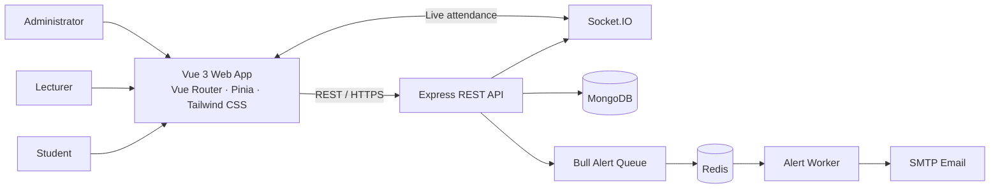
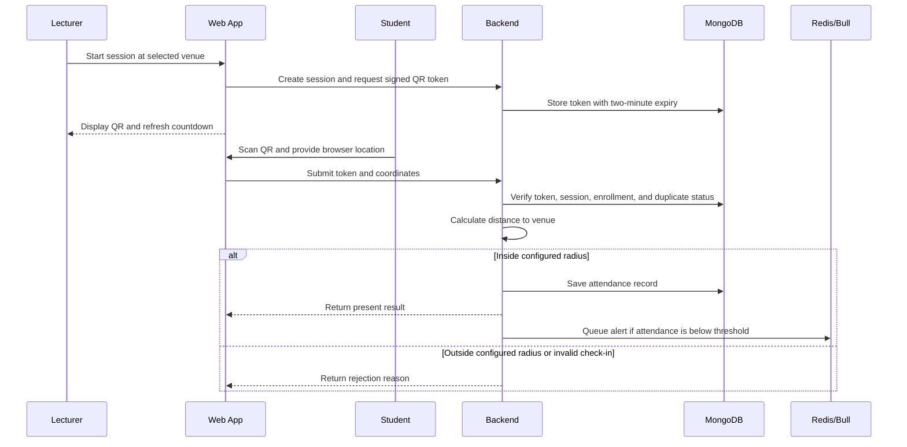

# Student Attendance Management System

A role-based web attendance platform for university classes. Lecturers start sessions and display rotating QR codes; students scan from a browser, and the server validates the QR token and the student’s location against the selected venue’s geofence. Administrators manage users, courses, and venues.

## At a Glance

| Role | Main capabilities |
|---|---|
| Administrator | Manage students, lecturers, courses, enrollment, and venues; import students from CSV; view dashboard statistics |
| Lecturer | View assigned courses, select a venue, start and end sessions, display rotating QR codes, monitor attendance, and export reports |
| Student | View enrolled courses, scan a session QR code, check in within the venue geofence, and view attendance history |

## Architecture



### Check-in flow



The same QR token can be used by eligible students during its two-minute lifetime. A student can only check in once per session; the token is not globally invalidated by the first scan.

## Technology Stack

| Layer | Technologies |
|---|---|
| Frontend | Vue 3, Composition API, Vue Router, Pinia, Axios, Tailwind CSS v4, Vite |
| QR and location | `jsQR`, `qrcode`, browser camera APIs, HTML Geolocation API |
| Backend | Node.js, Express, Mongoose, JWT, `bcryptjs`, HMAC-SHA256 |
| Realtime and alerts | Socket.IO, Bull, Redis, Nodemailer/SMTP |
| Data and reports | MongoDB, CSV parsing, CSV export, PDFKit |
| PWA | `vite-plugin-pwa`, generated web manifest and service worker, static app-shell precache |

## Repository Layout

```text
attendance-system/
├── backend/       Express API, models, controllers, routes, and Jest tests
├── frontend/      Vue application and PWA configuration
├── README.md
└── .gitignore
```

Environment-specific configuration is supplied through `.env.example` templates. Use your own local values and never commit real credentials.

## Requirements

- Node.js compatible with the frontend’s declared engine (`22.18+` or `24.12+`)
- npm
- MongoDB database
- Redis service
- SMTP account for absenteeism email alerts

## Local Development

1. From the repository root, install each app’s dependencies:

   ```bash
   npm --prefix backend install
   npm --prefix frontend install
   ```

2. Create local environment files from the placeholders:

   ```powershell
   Copy-Item backend/.env.example backend/.env
   Copy-Item frontend/.env.example frontend/.env.local
   ```

   Edit `backend/.env` locally with your MongoDB URI, strong `JWT_SECRET` and `HMAC_SECRET` values, Redis URL, SMTP settings, and `CLIENT_URL`. Do not commit this file or paste its values into issues or chat. `PORT` is optional, but the Vite development proxy targets port `5001`; set the backend `PORT=5001` for the default local setup, or change the proxy in `frontend/vite.config.js` to match another backend port.

   `frontend/.env.local` is optional for local development because Vite proxies `/api` and `/socket.io`. For a production frontend build, set `VITE_API_URL` to the deployed backend origin.

3. Start Redis. For Ubuntu/WSL with Redis installed:

   ```bash
   sudo service redis-server start
   redis-cli ping
   ```

   Redis should respond with `PONG`. Docker or a managed Redis instance can also be used; set `REDIS_URL` to the corresponding connection URL.

4. Start the backend in one terminal:

   ```bash
   npm --prefix backend run dev
   ```

   The backend validates required environment variables at startup and starts its MongoDB, Socket.IO, and alert-worker services.

5. Start the frontend in another terminal:

   ```bash
   npm --prefix frontend run dev
   ```

   Open the local URL printed by Vite, typically `http://localhost:5173`.

Before deployment, provision the initial administrator through a trusted setup process. Do not use shared default credentials in a hosted environment.

## Verification

Run the backend tests:

```bash
npm --prefix backend test
```

Some database integration test cases require a dedicated `TEST_MONGO_URI`. Without it, those cases may return early; use a disposable test database to exercise them fully.

Build and preview the production frontend, including the generated PWA files:

```bash
npm --prefix frontend run build
npm --prefix frontend run preview
```

The service worker precaches static app-shell assets. API requests are network-only, so login, attendance, reports, and other authenticated workflows are not available offline.

## Security

- Keep `.env` files and all real secrets out of Git. The ignore rules cover environment files at nested levels while allowing `.env.example` placeholders.
- CSV-imported students currently receive the implementation’s default initial password; change it before production use.
- Use a separate, disposable database and non-production credentials for testing.
- Browser-provided coordinates are client input. Geofencing checks distance to the configured venue; it does not independently prove a device’s location is genuine.

## API Areas

The API is organized around these route groups:

| Prefix | Purpose |
|---|---|
| `/api/auth` | Login, logout, current user |
| `/api/admin` | User, course, venue, import, and dashboard management |
| `/api/lecturer` | Lecturer courses and venues |
| `/api/student` | Student course list |
| `/api/sessions` | Create, list, refresh QR, attendance, and end sessions |
| `/api/attendance` | Check-in and student attendance history |
| `/api/reports` | Course statistics and CSV/PDF exports |
